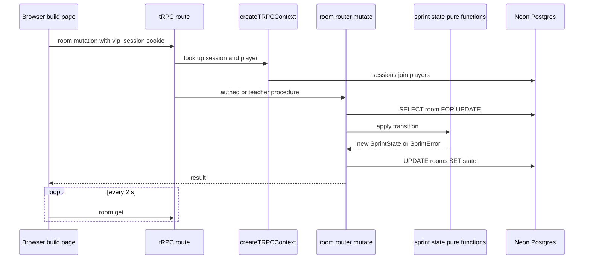
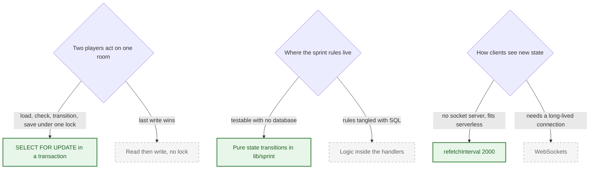

# VIP

A Next.js classroom game for reading code: practice questions, and a team sprint (planning, standup, work, review, retro) played in a shared room. tRPC, Drizzle and Neon Postgres.

## System design

How a request or a run moves through the code, then the choices behind that shape. In the decision charts, a **solid** box is the route this repo takes and a **dashed** box is the alternative it turns down; the edge label is the tradeoff.

### Request path

A Next.js app with tRPC. A `vip_session` cookie resolves to a player in the tRPC context, and every room mutation runs inside one Postgres transaction that locks the room row, applies a pure transition from `src/lib/sprint/state.ts`, and saves the new state. Clients poll `room.get` every 2 seconds.

### Why this shape

Game rules are pure functions, so `scripts/check-sprint-logic.ts` can test them without a database, and a SprintError becomes a BAD_REQUEST. The row lock serialises two teams acting on one room. Polling a small JSON state every 2 seconds keeps the deploy a plain serverless app.

